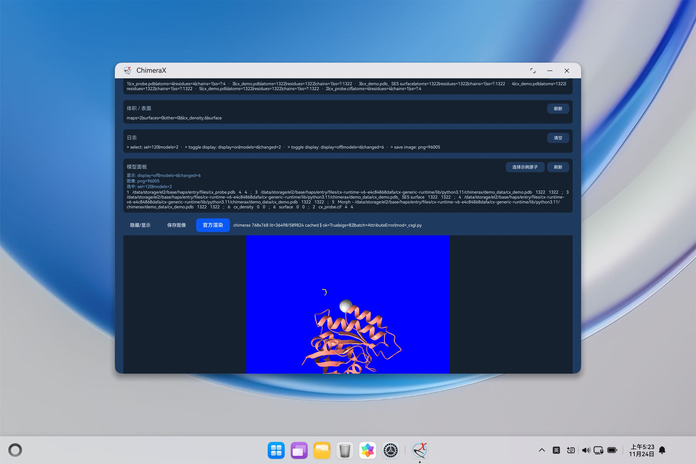

# ChimeraX × HarmonyOS PC

在 OpenHarmony 6.1.1 / API 24（aarch64）上运行 UCSF ChimeraX v1.11.1。应用用 ArkUI 提供界面，内嵌 CPython 3.11.18 和 ChimeraX 引擎；不是桌面 Qt 版的完整替代。上游版本和文件指纹见 [upstream.lock.json](upstream.lock.json)。



*历史界面截图（2026-11-24），用于展示适配效果，不是当前 HAP 的验收证据。*

## 能力与验收

| 级别 | 范围 |
| --- | --- |
| **T0 · 已在模拟器验证** | 引擎启动、示例 PDB/mmCIF/SDF 读取、结构显示；官方渲染器绘制彩色蛋白和密度等值面；拖动/缩放、选择高亮和 PNG 导出。 |
| **T1 · 部分覆盖或待复验** | ArkUI 模型、结构、体积/表面、链序列和日志面板；部分命令、表面封盖探针。当前版包含 PDB `save` 修复，尚未对新 HAP 完成设备验收。 |
| **T2 · 未覆盖** | 原生 Qt 窗口、桌面 GUI 和插件的完整兼容性、实体鸿蒙 PC 验收。 |

上一版 HAP 的模拟器验收为 **50/50**；当前 HAP 已构建，但模拟器安装因空间不足（`9568288`）未通过，未执行后续设备断言。详见 [验收记录](docs/PGC-VALIDATION-2026-11-21.md)。

## 快速开始

```bash
bash scripts/verify.sh --local       # 本地单元测试，无需 DevEco 或设备
bash scripts/verify.sh --build-only  # 使用仓库内的运行时构建 HAP
bash scripts/verify.sh               # 本地测试 + 构建 + 模拟器验收
```

构建环境、设备配置和常见问题见 [OpenHarmony 中文指南](README.OpenHarmony_CN.md)。技术设计和历史记录见 [文档索引](docs/README.md)。

## 许可证

见 [UCSF ChimeraX Non-Commercial Software License Agreement](LICENSE.md)。商业使用需要另行签订协议；分发上游软件或其衍生改动前须核对许可范围，并在条款要求时取得 UCSF 书面许可。此仓库不代表 UCSF 官方发布。
